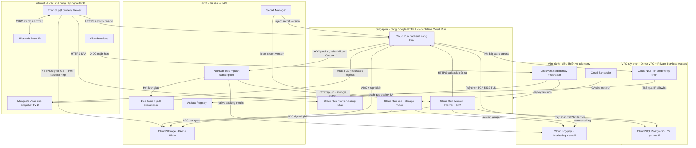

# Báo cáo thiết kế · Project 07

**Cloud Photo Gallery with Thumbnail Processing**  
**Khu vực triển khai** Singapore, `asia-southeast1`.  
**URL nộp bài** Xuất từ `terraform -chdir=infra output` sau lần triển khai. Chia sẻ tài khoản demo qua kênh riêng. Nộp workflow run, revision và evidence theo checklist cuối trang.

## 1. Kiến trúc và giải trình [25%]

Sơ đồ dùng tên dịch vụ và đường truyền của gói Terraform. Hai đường DB thể hiện hai cấu hình. Ghi lại đường nhóm thực sự chạy trong bản nộp và bỏ nhánh không dùng khỏi sơ đồ cuối. Runtime và kho GCS ở Singapore. Pub/Sub lưu message vào vùng đã chọn. Cloud SQL là instance ZONAL đơn trong VPC tuỳ chọn. Entra, GitHub và Atlas có failure domain độc lập.

Handoff mục tiêu ghi Ảnh, ProcessingJob và Outbox trong một giao dịch. Relay đọc bản ghi đã commit và publish ít nhất một lần. Consumer kiểm tra định danh business `PHOTO_UPLOADED:v1:<photoId>` theo hợp đồng hiện tại. Hai key dưới `thumbnail/<photoId>/` là cố định. Khi cùng key đã tồn tại, Worker xác minh nguồn và tận dụng derivative đã ghi, sau đó commit completion và khóa dedup cùng giao dịch rồi ACK. Với API multipart hiện tại, client upload qua Backend, bản ghi queue có thể kẹt giữa DB và publish; xem audit. Signed PUT/finalize là luồng cần TV 1/2/4 tích hợp.

| Failure domain | Ảnh hưởng và cách hệ thống phục hồi |
| --- | --- |
| Worker revision hoặc container chết giữa hai bước | Pub/Sub không nhận ACK, giao lại. Key ổn định và commit có điều kiện bảo vệ tính nhất quán. Rollback theo revision theo runbook. |
| DB unavailable hoặc commit thất bại | Giữ job chưa hoàn tất. Retry có giới hạn. Khi DB trở lại, relay hoặc operator reconcile dùng cùng business key. |
| Pub/Sub lỗi tạm | Ghi Outbox trước để job tìm lại được sau gián đoạn. Dùng backlog age và tuổi job DB để thấy cả trước và sau publish. |
| Tệp hỏng hoặc kết quả không hợp lệ | Worker xác minh bytes, ghi `FAILED` và lý do dễ đọc. Lỗi bất định trả non-2xx cho retry/DLQ. |
| Singapore hoặc Cloud SQL zone gián đoạn | Môi trường demo chỉ một vùng và một DB zone. Backups theo ngày, Pub/Sub có retention 48 giờ, DLQ 7 ngày. Ghi RTO/RPO đo được khi nhóm thực hành khôi phục. |
| Entra hoặc Atlas ngoài GCP gián đoạn | UI có thể mất đăng nhập hoặc API mất DB; theo dõi JWT/JWKS và DB health theo error code. Tách thời điểm khôi phục dịch vụ ngoài khỏi sự cố Worker. |

## 2. Triển khai và tự động hoá [20%]

Terraform dựng ba service, bucket, message policies, secret containers, IAM, monitoring và optional VPC/SQL/NAT. Workflow nhận commit source từng thư mục, build bằng npm lock, đẩy image dạng SHA/run, rồi triển khai theo digest. Chỉ deploy identity của repo ID, owner ID, branch và workflow đã chốt. Terraform kiểm soát cấu hình; Cloud Run revision image và tỷ lệ traffic do CI/điều hành kiểm soát. Evidence gồm log `terraform plan/apply`, revision ID, digest, workflow ID, ảnh chụp traffic trước và sau rollback và kết quả recreate. [Deploy guide](deploy_guide.md)

## 3. Bảo mật và tính đúng [15%]

API là entry point HTTPS công khai có xác thực ứng dụng; Cloud Run Worker dùng ingress Internal và IAM kiểm tra caller. Pub/Sub cùng project đi tới URL run.app mặc định qua mạng Google. Chỉ cấp `run.invoker` của Worker cho Pub/Sub Push SA trong module và kiểm tra quyền kế thừa của project. Backend/Worker tách runtime SA, có quyền data plane theo bucket/topic/secret được sử dụng. Signed URL giới hạn 15 phút ở snapshot, bucket dùng PAP và UBLA. Kiểm quyền trước khi ký link và không ghi secret vào Terraform state. Credential app lấy từ Secret Manager. GitHub dùng token ngắn hạn. Test bằng hai người dùng và request GCS vô danh, tách bằng session. [Audit](integration_audit.md)

## 4. Độ tin cậy và quan sát [15%]

Dashboard có tuổi job, p95 latency từ lúc tạo event, tỉ lệ terminal thất bại, lượt retry và số byte derivative. Pub/Sub phản ánh tuổi sau publish; tiến độ Outbox trước publish cần gauge DB. Sự cố demo đi từ partial GCS, container exit, không ACK, alert tới rollback và xác minh job cuối. Dùng Logs Explorer truy vết photoId/jobId/messageId và thu log đã lọc. [Monitoring runbook](monitoring_runbook.md)

## 5. Độ hoàn thiện ứng dụng [15%]

Demo đăng nhập owner, tạo album, upload, thấy progress, đủ hai thumbnail và xem bằng tài khoản được mời. Unrelated user bị chặn qua API. Chạy Test 1–3 trên workspace staging sạch bằng script, đối chiếu sổ job và dedup. Giữ kết quả fail nếu hợp đồng phiên bản hiện tại chưa hỗ trợ; ghi issue và revision xử lý. [Kịch bản demo](demo_script_12min.md)

## 6. Chi phí và giao tiếp [10%]

Chốt tải kiểm thử và tier với nhóm trước khi đo. So chi phí Cloud Run scale-to-zero, GCS, Pub/Sub và Atlas hoặc Cloud SQL 730 giờ theo khối lượng, cân nhắc NAT IP cho Atlas, ghi nhận khoản tồn lại sau cleanup. [Ước tính và cleanup](cost_and_cleanup.md)

## Gói bằng chứng nộp bài

| Bằng chứng | Nội dung cần thu từ thực tế |
| --- | --- |
| URL và danh tính demo | Frontend, Backend health, Swagger, tài khoản thử owner/viewer qua kênh riêng |
| Recreate và CI | Project, region, commit, workflow run, image digest, hai revision, ảnh traffic trước/sau rollback |
| Kiểm thử | Dataset manifest + raw JSON, Test 1 100/200, Test 2 5 ACK và 1 commit, Test 3 5/5 FAILED, báo cáo bảo mật |
| Độ tin cậy | Job ID từ drill, ảnh partial và final objects, alert và thời điểm xử lý, DLQ nếu phát sinh |
| Hiệu năng | URL endpoint không query, thời lượng, warmup, tải gửi thật, concurrency, số mẫu, error rate và p95 |
| Chính xác DB | Xuất kết quả đọc 1 Image, 1 ProcessingJob hoàn tất, 1 ProcessedEvent theo cùng business key; không xuất DB credentials |
| Chi phí | Giả định hàng tháng, billing export đã lọc, thời gian destroy và đầu ra xác minh |
